<picture>
  <source media="(prefers-color-scheme: light)" srcset="./assets/hero-light.svg">
  
</picture>

<picture>
  <source media="(prefers-color-scheme: light)" srcset="./assets/terminal-light.svg">
  
</picture>

<picture><source media="(prefers-color-scheme: light)" srcset="./assets/divider-light.svg"></picture>

## ⚙️ Stack

<picture>
  <source media="(prefers-color-scheme: light)" srcset="./assets/stack-light.svg">
  
</picture>

## 🚀 What I'm building

<table><tr>
<td width="50%" valign="top">

### 🟣 Nimo Club — Tech Lead
Community platform with an **AI studio**, **tournaments** and **subscription plans**. 
`React + Vite` `Node.js` `Prisma` `Supabase`
</td>
<td width="50%" valign="top">

### 🌐 Media origin / CDN
nginx-based media origin for Nimo Club, plus its **sales landing page**. 
`nginx` `Vercel`
</td>
</tr></table>

<picture><source media="(prefers-color-scheme: light)" srcset="./assets/divider-light.svg"></picture>

## 🏙️ Commit City
My last 52 weeks of GitHub activity rendered as a skyline — rebuilt every day by a GitHub Action.

<picture>
  <source media="(prefers-color-scheme: light)" srcset="./assets/skyline-light.svg">
  
</picture>

<b>🇧🇷 Em português</b>

 

Dev Full Stack Sênior e Tech Lead no **Nimo Club** (comunidade, Estúdio de IA, campeonatos e planos de assinatura). Trabalho com TypeScript, React, Next.js e Node.js, com Prisma, Supabase, nginx e Vercel.

**Aberto a vagas remotas** — Brasil 🇧🇷, EUA 🇺🇸 e Portugal 🇵🇹. Contato: [LinkedIn](https://linkedin.com/in/roni0028).

A "Commit City" acima é gerada todo dia por um GitHub Action: cada prédio é uma semana de contribuições, e as janelas acesas são os dias ativos.

